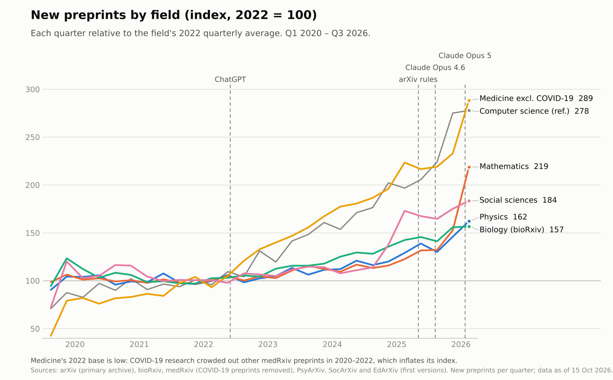
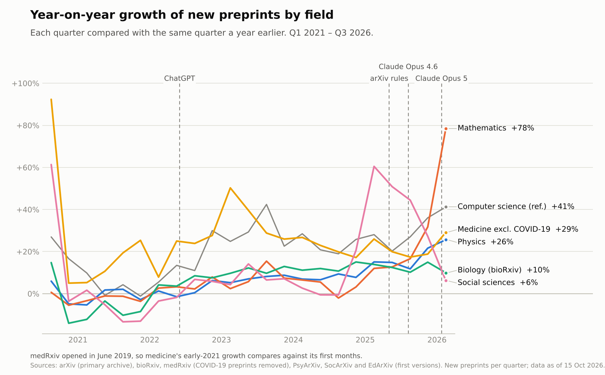
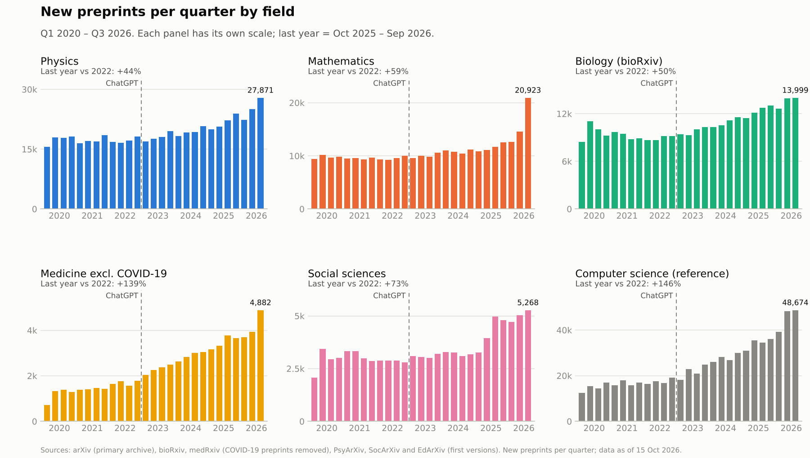
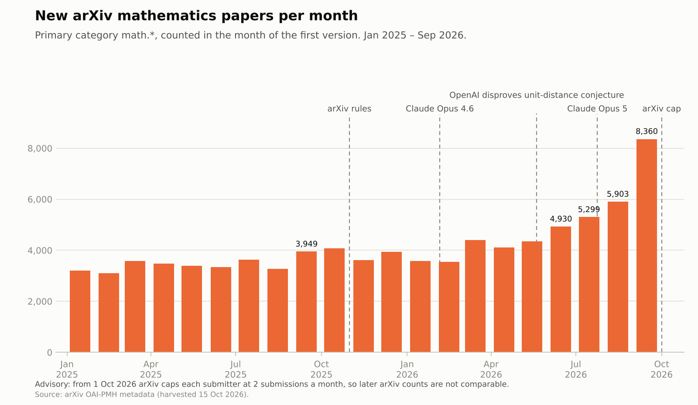
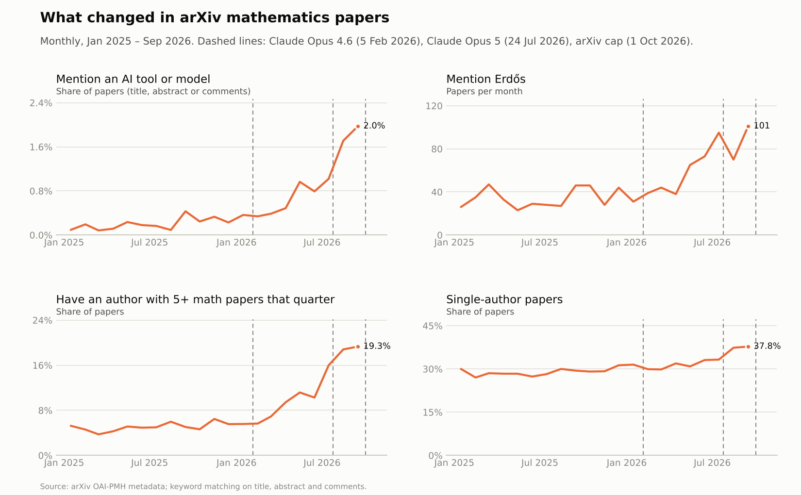
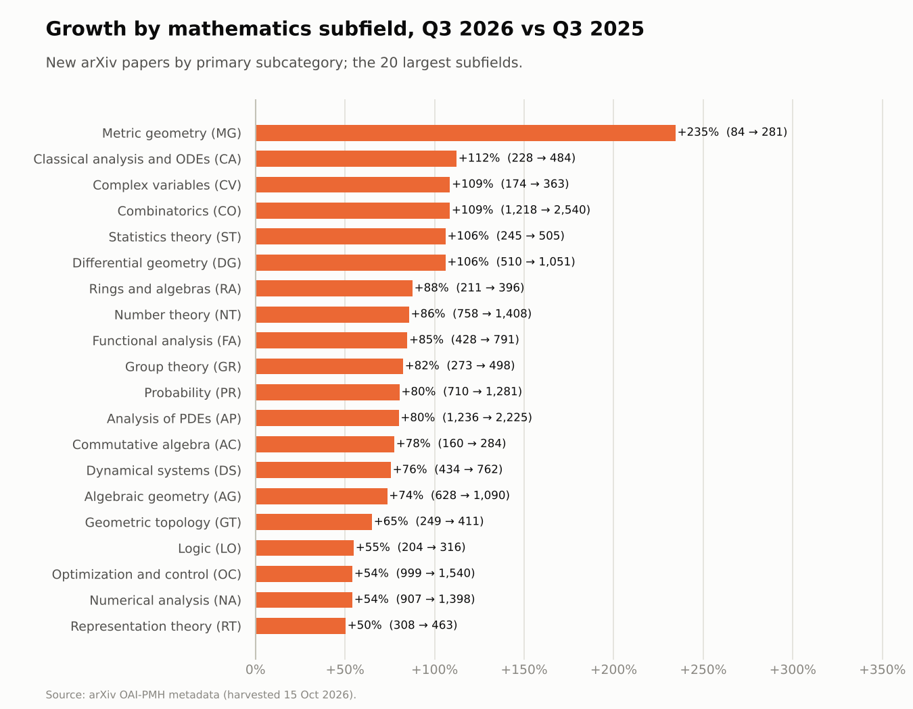
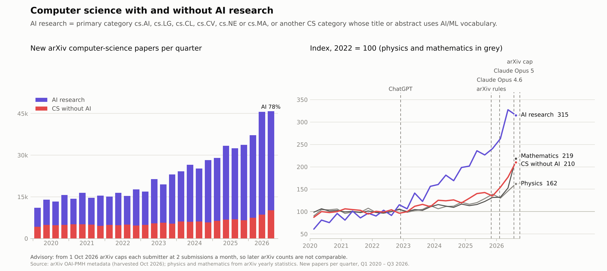

# academia-ia-state

Estudio del estado de la academia (publicaciones, ayudas y becas) y del impacto de los LLM en todas las disciplinas.

## Contenido

| Ruta | Qué es |
|---|---|
| `docs/data-sources-report.md` | Catálogo de fuentes (en inglés): qué mide cada fuente, cobertura histórica, acceso, coste, rupturas conocidas y una estrategia para separar el efecto de los LLM de otros factores. |
| `docs/research-notes/` | Notas de investigación con todas las citas en las que se basa el informe. Las rutas a `/tmp/...` que aparecen en ellas son de la sesión de trabajo y no se conservan. |
| `docs/figures/` | Gráficos en inglés (PNG). |
| `dashboards/preprints-por-campo/` | Código del panel «Preprints by Field». |
| `data/raw/` | Datos descargados de las fuentes, sin transformar. |
| `data/processed/` | Series listas para usar. |
| `scripts/` | Scripts para descargar y regenerar datos y gráficos. |

## Preprints nuevos por trimestre (desde 2020-Q1)

`data/processed/preprints_by_field_quarterly.csv` tiene una fila por trimestre completo.

| Columna | Fuente | Qué cuenta |
|---|---|---|
| `physics` | arXiv | Envíos nuevos cuyo archivo principal es de física: astro-ph, cond-mat, gr-qc, hep-ex, hep-lat, hep-ph, hep-th, math-ph, nlin, nucl-ex, nucl-th, physics y quant-ph. |
| `mathematics` | arXiv | Envíos nuevos con archivo principal math. |
| `biology_biorxiv` | bioRxiv | `new_papers` del resumen mensual oficial (sin revisiones). |
| `medicine_medrxiv_no_covid` | medRxiv | Preprints nuevos menos los de COVID-19 (`medrxiv_covid`). |
| `medicine_medrxiv_all`, `medrxiv_covid` | medRxiv | Total de preprints nuevos y los que mencionan COVID-19, SARS-CoV-2 o 2019-nCoV en título o resumen. |
| `social_sciences` | Suma | psyarxiv + socarxiv + edarxiv + arxiv_econ_finance. |
| `psyarxiv`, `socarxiv`, `edarxiv` | OSF | Preprints nuevos (solo primeras versiones) por fecha de creación. |
| `arxiv_econ_finance` | arXiv | Envíos nuevos con archivo principal econ o q-fin. |
| `computer_science_reference` | arXiv | Envíos nuevos con archivo principal cs; solo como referencia. |

Los conteos de arXiv salen de las páginas de estadísticas anuales por archivo (`https://arxiv.org/year/<archivo>/<año>`), que dan envíos nuevos y listados cruzados por mes. Solo se usan los envíos nuevos.







## El salto de matemáticas en 2026

`scripts/harvest_arxiv_oai.py` descarga los metadatos de todos los artículos de matemáticas de arXiv modificados desde enero de 2025 (OAI-PMH). `scripts/analyze_math.py` los resume por mes:

- `data/processed/arxiv_math_monthly_profile.csv`: artículos, menciones de herramientas de IA, de Erdős y de Lean, artículos de un solo autor, autores nuevos y autores muy prolíficos.
- `data/processed/arxiv_math_subcategories.csv`: crecimiento por subárea, T3 2025 frente a T3 2026.

El mes de cada artículo sale de su identificador (`YYMM.NNNNN`): el campo `<created>` de OAI no siempre es la fecha de la primera versión. Estos conteos quedan entre un 6 y un 13 % por debajo de las páginas anuales de arXiv, que cuentan además los alias entre archivos (por ejemplo, math-ph/math.MP), pero la tendencia coincide.







`scripts/robustness_math_prolific.py` comprueba el indicador de autores prolíficos frente a homónimos, tamaño de equipo, subárea y fecha (`data/processed/arxiv_math_prolific_robustness.json`).

## Informática con y sin investigación en IA

`scripts/harvest_arxiv_oai.py --set cs` descarga los metadatos de informática desde 2020 y `scripts/analyze_cs_ai.py` separa por trimestre:

- la investigación en IA: categoría principal cs.AI, cs.LG, cs.CL, cs.CV, cs.NE o cs.MA, u otra categoría de informática cuyo título o resumen usa vocabulario de IA o aprendizaje automático;
- el resto.

Salidas: `data/processed/arxiv_cs_ai_split_quarterly.csv` y `arxiv_cs_categories_quarterly.csv`. Estos totales quedan entre un 5 y un 11 % por debajo de las páginas anuales de arXiv por los alias entre archivos.



## Versiones para publicación

`docs/figures/paper/` contiene las figuras 1, 4 y 5 sin título, en SVG, PDF y PNG a 300 dpi y a 85 y 175 mm, con leyendas y notas de métodos (`scripts/plot_paper.py`).

### Advertencias

- **Un preprint no es una publicación.** La adopción del preprint varía mucho por campo: casi universal en física y matemáticas, parcial en biología y medicina, minoritaria en ciencias sociales. Compara la evolución de cada campo, no los niveles entre campos.
- **Ciencias sociales es una muestra pequeña.** Faltan SSRN y RePEc, porque no se pudieron obtener recuentos trimestrales fiables.
- **COVID-19 en medRxiv.** El filtro usa palabras clave en título y resumen. En los últimos años también excluye artículos que solo citan la pandemia como contexto, así que es un filtro conservador.
- **Alias de arXiv.** La suma de todos los archivos supera el total mensual oficial en torno a un 5 %, porque algunas categorías son alias entre dos archivos (math-ph/math.MP, cs.IT/math.IT, math.ST/stat.TH, cs.NA/math.NA, eess.SY/cs.SY, econ.GN/q-fin.EC). `parse_arxiv.py` imprime la diferencia mes a mes.
- **Versiones en OSF.** Desde principios de 2025 la API de OSF devuelve cada versión como un registro aparte (`<id>_vN`). `osf_quarterly.py` usa el total de la API hasta 2024 y, desde 2025, pagina los registros y cuenta solo `_v1`.
- **Menciones de IA.** Las menciones de herramientas de IA se buscan solo en título, resumen y comentarios, no en el texto completo, así que subestiman su uso real.
- **Rupturas conocidas.**
  - COVID-19 en 2020–2021.
  - Cambios de normas de arXiv entre octubre de 2025 y octubre de 2026:
    - artículos de revisión y de posición en informática;
    - aval de autores nuevos;
    - versión completa en inglés;
    - límite de 2 envíos al mes por persona, anunciado y aplicado el 1 de octubre de 2026.
  - SocArXiv exigió ORCID y derivó las humanidades a otro repositorio en noviembre de 2025.
- **Hitos marcados en los gráficos.** ChatGPT (30 nov 2022), cambios de normas de arXiv (31 oct 2025), Claude Opus 4.6 (5 feb 2026) y Claude Opus 5 (24 jul 2026). El gráfico mensual de matemáticas marca además el anuncio de OpenAI sobre la conjetura de las distancias unitarias (20 may 2026). Las versiones para publicación solo marcan ChatGPT, las normas de arXiv (incluido el límite de envíos del 1 de octubre de 2026) y Claude Opus 5. Otros laboratorios lanzaron modelos en los mismos meses: los marcadores indican fechas, no causas.

## Regenerar los datos

```bash
scripts/fetch_arxiv_years.sh /tmp/arxiv_years            # páginas anuales por archivo (no se versionan)
python3 scripts/parse_arxiv.py /tmp/arxiv_years data/raw/arxiv_archive_monthly.csv
cp /tmp/arxiv_years/monthly_submissions.csv data/raw/arxiv_monthly_submissions.csv
scripts/fetch_biorxiv_medrxiv.sh data/raw
python3 scripts/harvest_medrxiv_details.py 2019-06 2026-09 data/raw/medrxiv_covid_monthly.csv   # lento
python3 scripts/osf_quarterly.py data/raw/osf_quarterly.csv   # lento: pagina los registros desde 2025
python3 scripts/build_datasets.py data
python3 scripts/harvest_arxiv_oai.py --set math --from 2025-01-01 --min-created 2025-01-01 /tmp/math.jsonl.gz   # lento
python3 scripts/analyze_math.py data/processed /tmp/math.jsonl.gz
python3 scripts/robustness_math_prolific.py data/processed/arxiv_math_prolific_robustness.json /tmp/math.jsonl.gz
python3 scripts/harvest_arxiv_oai.py --set cs --from 2020-01-01 --min-created 2020-01-01 /tmp/cs.jsonl.gz   # lento
python3 scripts/analyze_cs_ai.py data/processed /tmp/cs.jsonl.gz
python3 scripts/plot_static.py .                          # requiere matplotlib
python3 scripts/plot_paper.py .                           # versiones para publicación
```

`build_datasets.py` conserva solo trimestres completos, desde 2020-Q1 hasta el último trimestre cerrado antes de la fecha en que se ejecuta. `scripts/osf_check_quarter.py <servidor> <desde> <hasta>` sirve para comprobar a mano un trimestre de OSF.
