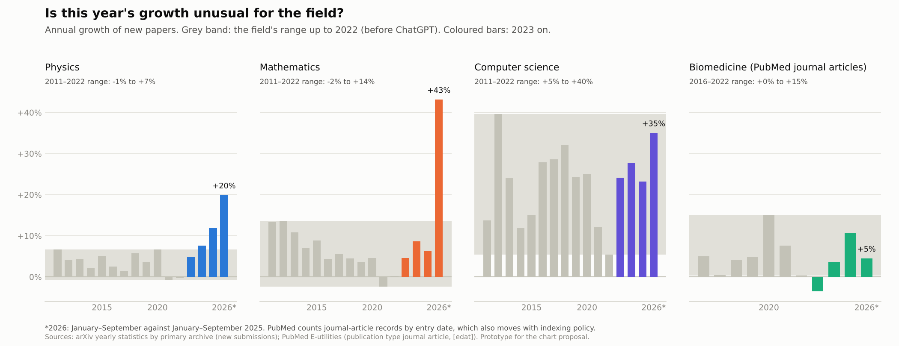
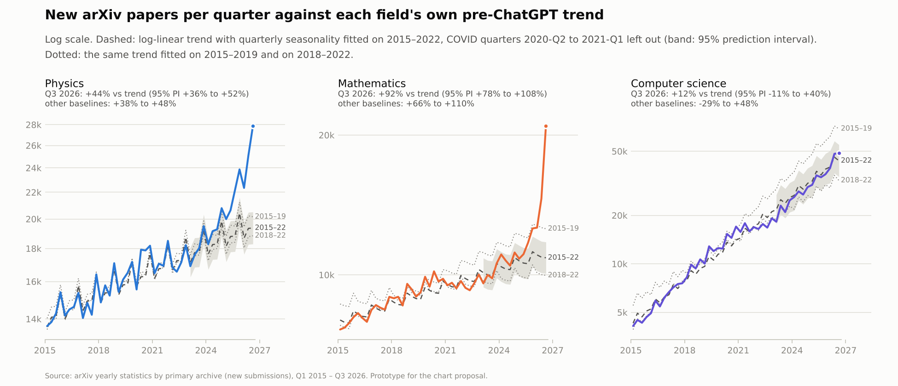
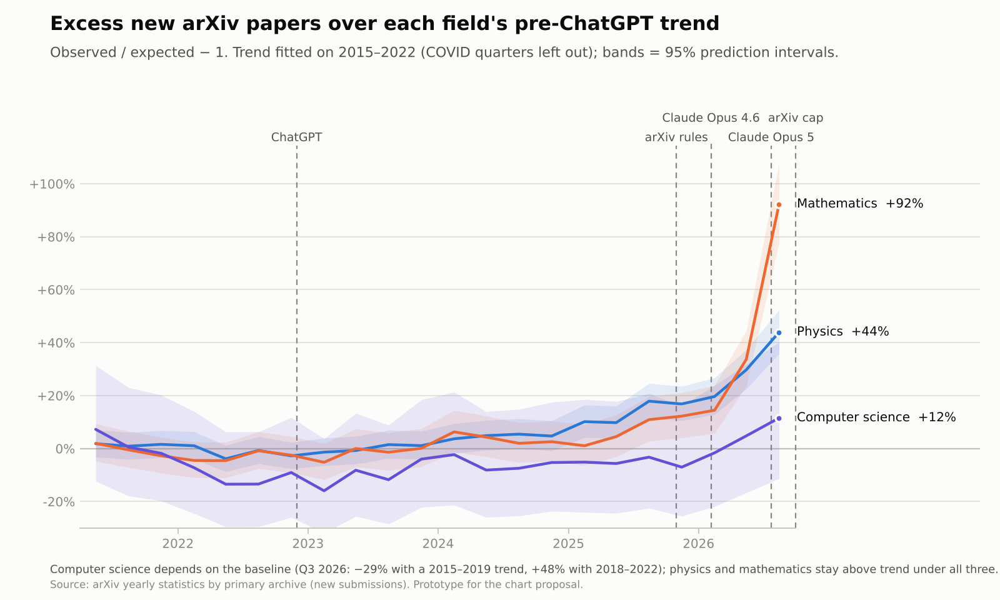
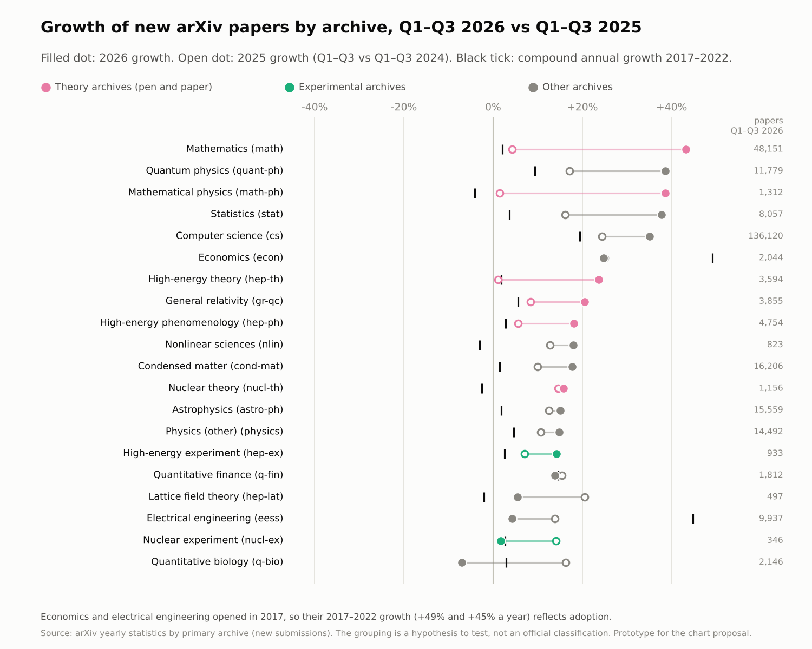

# Propuesta: cómo mejorar las gráficas de papers

16 de octubre de 2026. Los prototipos están en `docs/figures/proposal/` y salen de `scripts/analyze_trends.py` y `scripts/plot_proposal.py`, con datos reales: arXiv por archivo desde 2010, bioRxiv y PubMed.

## Resumen

- **El gráfico principal debería responder a otra pregunta.**
  - El índice 2022 = 100 dice cuánto ha crecido cada campo, no si ese crecimiento es anómalo.
  - Para medir el efecto de los LLM, la pregunta útil es cuánto se aparta cada campo de **su propia tendencia previa**.
  - Así se mide el exceso de mortalidad (observado / esperado − 1) y así trabajan los estudios contrafactuales sobre publicaciones (sección 1).
- **Con esa lente cambia la lectura de informática.**
  - Su crecimiento de 2023–2025 (+23 % a +28 % al año) es el mismo que en 2016–2020, antes de ChatGPT.
  - Física y matemáticas, en cambio, salen de su rango histórico: física desde 2024–2025 y matemáticas en 2026.
- **El gradiente dentro de cada campo es la prueba más directa de la hipótesis de la ola.** En arXiv, en 2026 aceleran más los archivos teóricos que los experimentales:
  - teóricos: matemáticas +43 %, física matemática +39 %, teoría de altas energías +24 %;
  - experimentales: altas energías +14 %, nuclear +2 %.
- **Hay que separar la adopción del preprint de la producción.** En biomedicina, ni lo publicado ni los preprints aceleran en 2026 (enero–septiembre):
  - PubMed: +5 %, tras +11 % en 2025;
  - bioRxiv: +12 %, tras +13 % en 2025.
- **Faltan dos medidas que la literatura usa y nosotros no:**
  - descomponer el crecimiento en autores × artículos por autor, con conteo fraccionario;
  - medir el uso de LLM por campo (vocabulario en exceso) y cruzarlo con la aceleración.

## 1. Qué métricas usa la comunidad

*En preparación: la revisión de las métricas de la bibliometría está en curso y se añadirá aquí.*

## 2. Qué falla en las gráficas actuales

| Gráfico | Problema | Mejora |
|---|---|---|
| Fig. 1, índice 2022 = 100 | Mezcla la tendencia previa con el cambio. Depende del año base (en medicina, 2022 está deprimido por la COVID-19). No muestra incertidumbre. | Crecimiento frente al rango histórico del campo (P4) o exceso sobre la tendencia propia con intervalo (P1, P2). El índice puede quedar como gráfico descriptivo, en escala logarítmica y desde 2015. |
| Fig. 2, crecimiento interanual | Es ruidoso trimestre a trimestre y no dice si un +26 % es normal en ese campo. Los efectos base de 2020–2021 dominan el principio. | El mismo gráfico con la banda del rango previo del campo, como en P4. |
| Fig. 3, recuentos por campo | Escalas lineales distintas en cada panel. Empieza en 2020, sin historia. | Escala logarítmica, en la que la pendiente es la tasa de crecimiento, desde 2015 y con la tendencia previa superpuesta (P1). |
| Fig. 4–6, matemáticas | Sin referencia histórica: no se ve si un +80 % es inusual en cada subárea. El umbral de autor prolífico (5 artículos en un trimestre) es propio y no es comparable con la literatura. | Crecimiento previo de cada subárea como en P3. Umbral alineado con la literatura sobre autores hiperprolíficos y medidas de concentración, como la cuota de artículos del 1 % de autores más productivos. |
| Fig. 7, informática con y sin IA | La serie empieza en 2020, así que no hay tendencia previa de la informática sin IA. La clasificación por vocabulario se desplaza: cuantos más artículos mencionan LLM, más pasan al grupo de IA. | Ampliar la descarga a 2015 y calcular el exceso sobre tendencia de cada grupo. Repetir con la clasificación solo por categoría. |
| Todos | Las líneas verticales de lanzamientos sugieren causa. Los periodos provisionales no se distinguen. | Bandas para los regímenes de reglas (octubre 2025 – octubre 2026) y una marca en el trimestre en que la serie sale de su intervalo de predicción. |

## 3. Prototipos con datos reales

### 3.1 Crecimiento frente al rango histórico (P4)

Es la versión más simple y no necesita modelo: el crecimiento anual de cada campo frente a su rango hasta 2022.

| Campo | Rango hasta 2022 | 2023 | 2024 | 2025 | 2026* |
|---|---|---|---|---|---|
| Física | −1 % a +7 % (2011–2022) | +5 % | +8 % | +12 % | +20 % |
| Matemáticas | −2 % a +14 % (2011–2022) | +5 % | +9 % | +6 % | +43 % |
| Informática | +5 % a +40 % (2011–2022) | +24 % | +28 % | +23 % | +35 % |
| Biomedicina (PubMed) | 0 % a +15 % (2016–2022) | −3 % | +4 % | +11 % | +5 % |

\*Enero–septiembre frente a enero–septiembre de 2025.

### 3.2 Exceso sobre la tendencia propia (P1, P2)

**Método.**
- Para cada campo, se ajusta una regresión del logaritmo de los papers por trimestre sobre una tendencia lineal y efectos de trimestre.
- El ajuste usa solo trimestres anteriores a ChatGPT y se proyecta hacia delante.
- Exceso = observado / esperado − 1, con intervalo de predicción del 95 %.
- Quedan fuera los trimestres de la COVID-19 (2020-T2 a 2021-T1).
- La ventana de ajuste importa, así que pruebo tres: 2015–2022 (principal), 2015–2019 y 2018–2022.

| Campo, T3 2026 | 2015–2022 | 2015–2019 | 2018–2022 | Tendencia 2015–2022 |
|---|---|---|---|---|
| Física | +44 % [+36, +52] | +38 % | +48 % | +2,9 % al año |
| Matemáticas | +92 % [+78, +108] | +66 % | +110 % | +3,0 % al año |
| Informática | +12 % [−11, +40] | −29 % | +48 % | +22,5 % al año |
| Biología (bioRxiv) | no aplicable | no aplicable | −15 % [−47, +35] | — |
| Biomedicina (PubMed) | −8 % [−18, +3] | +13 % | −18 % | +5,5 % al año |

**Cuándo sale cada serie de su intervalo** (primer trimestre desde el que el límite inferior queda siempre por encima de cero):

| Campo | 2015–2022 | 2015–2019 | 2018–2022 |
|---|---|---|---|
| Física | 2025-T1 | 2025-T3 | 2024-T2 |
| Matemáticas | 2025-T3 | 2026-T2 | 2024-T1 |
| Informática | no sale | no sale | 2026-T1 |
| bioRxiv | — | — | no sale |
| PubMed | no sale | 2025-T1 | no sale |

**Lectura.**
- Física y matemáticas quedan muy por encima de su tendencia con cualquier ventana.
- El crecimiento reciente de informática no se distingue de su propia historia. Con la tendencia de 2015–2019 está un 29 % por debajo; con la de 2018–2022, un 48 % por encima.
- bioRxiv no admite el método antes de 2018: entonces aún se estaba adoptando y los preprints nuevos se duplicaban cada año. Con 2018–2022 el intervalo es demasiado ancho para concluir nada.
- PubMed depende de cómo se trate el repunte de la COVID-19.

### 3.3 Gradiente por archivo de arXiv (P3)

Crecimiento de enero–septiembre de 2026 frente al mismo periodo de 2025. Como referencia, el del año anterior y el crecimiento anual compuesto de 2017–2022.

- **Teóricos (lápiz y papel):**
  - matemáticas +43 %;
  - física matemática +39 %;
  - teoría de altas energías +24 %;
  - relatividad general +21 %;
  - fenomenología +18 %;
  - teoría nuclear +16 %.
- **Experimentales:** altas energías +14 %, nuclear +2 %.
- **Computacional:** teoría de campos en el retículo +6 %.
- **Otros:**
  - física cuántica +39 %;
  - estadística +38 %;
  - informática +35 %;
  - materia condensada +18 %;
  - astrofísica +15 %;
  - biología cuantitativa −7 %.

Todos los archivos teóricos crecen más que los dos experimentales, aunque la diferencia entre teoría nuclear y altas energías experimental es pequeña (+16 % frente a +14 %). Encaja con que los LLM aceleren primero donde el cuello de botella es razonar y escribir, no medir.

**Límites.**
- Los archivos experimentales son pequeños: 346 y 933 artículos en 2026.
- Física matemática comparte categorías alias con matemáticas.
- Estadística incluye aprendizaje automático (stat.ML).
- Física cuántica vive su propio auge.
- La división entre teóricos y experimentales es una hipótesis mía, no una categoría oficial.

## 4. Qué cambia en la conclusión de la ola

- **Se mantiene:**
  - la aceleración avanza campo a campo;
  - matemáticas y física teórica la muestran con claridad;
  - biología y medicina, no, ni en preprints ni en PubMed.
- **No se sostiene con estos datos:** que «informática va por delante porque es la más expuesta».
  - El agregado de informática sigue la tendencia que traía con el aprendizaje profundo.
  - La prueba buena es la informática sin IA con una tendencia previa larga, que exige ampliar la descarga a 2015.
- **Más precisa:** el orden parece ir por tipo de trabajo más que por campo. Primero la teoría, cuyo cuello de botella es razonar y escribir. Después, si llega, el trabajo experimental o de cálculo intensivo.

## 5. Plan propuesto

| # | Cambio | Datos | Esfuerzo | Estado |
|---|---|---|---|---|
| 1 | Crecimiento frente al rango histórico (P4) como gráfico principal, con el exceso sobre tendencia (P1, P2) como apoyo | Ya descargados | Bajo | Prototipo hecho |
| 2 | Gradiente por archivo (P3); después, por subárea de matemáticas e informática | Ya descargados | Bajo | Prototipo hecho |
| 3 | PubMed como serie de artículos publicados en biomedicina, y cociente entre preprints y artículos | Ya descargados | Bajo | Datos listos |
| 4 | Informática sin IA desde 2015, con exceso sobre tendencia | Descarga OAI de cs desde 2015 (horas) | Medio | — |
| 5 | Descomposición en autores × artículos por autor (fraccionario) y concentración por campo | Descarga OAI de math, cs y física (horas) | Medio-alto | — |
| 6 | Uso de LLM por campo (vocabulario en exceso) y gráfico de dosis y respuesta: uso frente a exceso de crecimiento | Resúmenes de arXiv (OAI) y de bioRxiv y medRxiv (API) | Medio-alto | — |
| 7 | Artículos publicados en todas las disciplinas (OpenAlex) | Clave de API, que requiere tu correo | Medio | Pendiente de tu decisión |
| 8 | Ciencias sociales: SSRN desde Crossref, con sus rupturas documentadas | Crossref, sin clave | Medio | — |

## 6. Decisiones

1. ¿Sustituyo en el ensayo y en el panel el índice 2022 = 100 por el crecimiento frente al rango histórico (P4), con el exceso sobre tendencia como apoyo? Recomiendo que sí.
2. ¿Lanzo las descargas largas de los puntos 4 a 6 (informática y matemáticas desde 2015, con autores y resúmenes)? Corren en segundo plano durante horas.
3. Si vas a preparar un Registered Report, conviene fijar las hipótesis a nivel de autor (punto 5) antes de mirar esos datos.
4. OpenAlex: ¿creas tú la clave o me autorizas a pedirla con tu correo?
